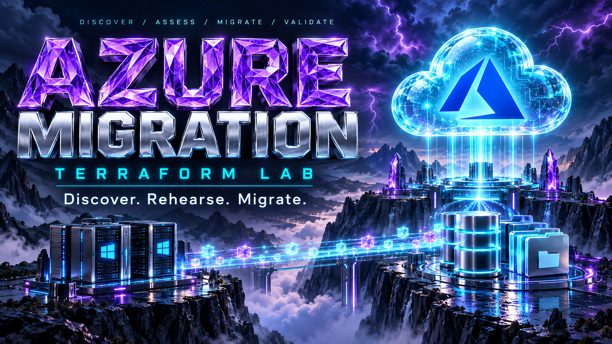
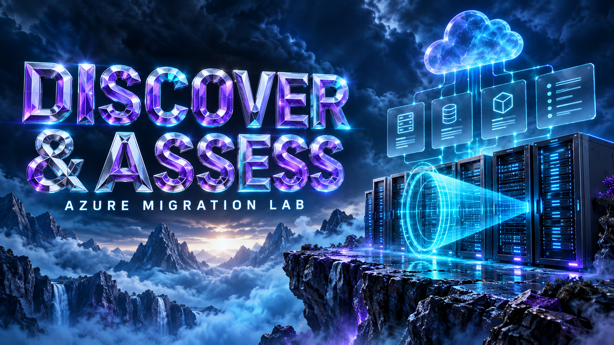
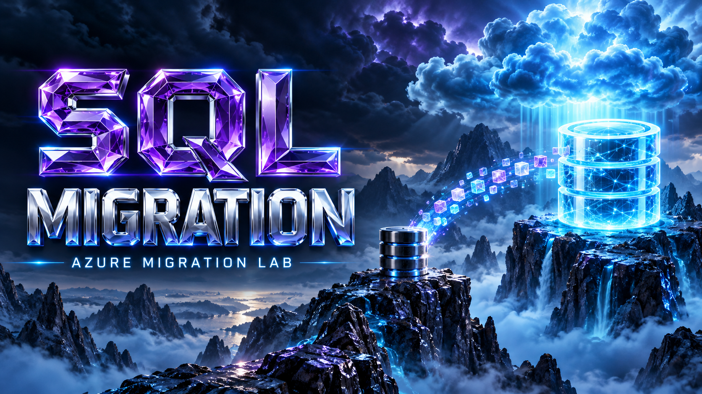
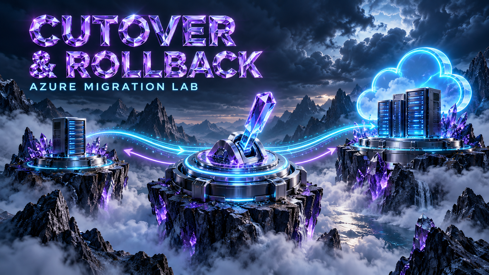
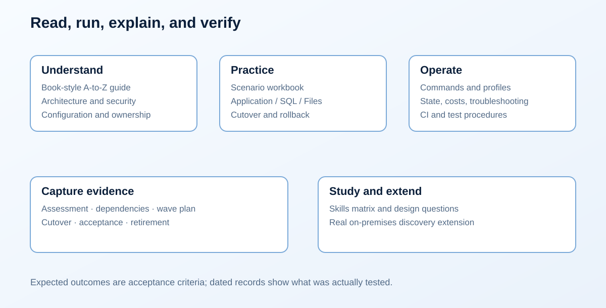

# Azure Migration Lab

  

Discover the source, rehearse the move, and migrate the application, database,
and files through a controlled cutover.

A practical migration lab for moving a small Windows application, relational
data, and files into an Azure target environment. It follows the visual,
documentation, and Terraform conventions of
[Azure Landing Zone Lab](https://github.com/Jamonygr/azure-landing-zone-lab).

The source runs IIS, SQL Server 2022 Express, and an SMB share on a Windows
Server 2022 VM. The target runs the application on a newly built IIS VM,
Azure SQL Database, and Azure Files. You practice inventory, assessment,
rehearsal, data transfer, validation, DNS cutover, rollback, acceptance, and
source retirement.

**Scope:** application and data migration between isolated Azure-hosted
environments. The target VM is rebuilt; its operating-system disk is not
replicated. Azure Migrate CSV import is an optional assessment exercise.
It does not turn this lab into an Azure Migrate server replication lab.
A [real on-premises extension](wiki/scenarios/real-onpremises.md) explains the
additional discovery/appliance work.

## Topology at a glance

~~~mermaid
flowchart LR
    S["Source VNet · 10.100.0.0/16"]
    T["Target VNet · 10.200.0.0/16"]
    S <-->|Private peering| T
    IIS["Source VM\nIIS + SQL Express + SMB"] --> STAGE["Private app staging"]
    STAGE --> APP["New target IIS VM"]
    IIS -->|Direct SQL import| SQL["Azure SQL Database"]
    IIS -->|Direct file copy| FILES["Azure Files"]
    DNS["app.migration.lab.internal"] --> APP
~~~

## What is included

- Four independently managed Terraform stacks: foundation, source, target,
  and cutover, with separate state.
- Four profiles: `cheap-lab`, `dev`, `lab`, and `prod`; a profile is a lab
  configuration, including when it demonstrates production-like controls.
- A small .NET catalog application with database-backed health checks,
  a write fence, seeded records, and migration evidence.
- PowerShell orchestration for the complete migration lifecycle and guarded
  destructive operations.
- Private service endpoints, managed identities, role assignments, monitoring,
  optional backup, and cost controls.
- A book-style guide, scenario workbook, diagrams, operational templates,
  generated Terraform references, checks, and CI configuration.

## Your migration journey

| Discover and assess | Move the workload | Validate and cut over |
|---|---|---|
|  |  |  |
| Inventory the source and plan migration waves. [Start discovery](wiki/scenarios/discover-assess.md). | Rebuild IIS, import SQL, and transfer files. [Open the workbook](wiki/scenarios/README.md). | Prove the target before acceptance. [Practice cutover and rollback](wiki/scenarios/cutover-rollback.md). |

The [visual gallery](wiki/reference/visual-gallery.md) collects all 12 cinematic
illustrations. Technical diagrams below and throughout the wiki describe the
actual resource relationships and migration boundaries.

## Start here

Install Terraform at the version in `.terraform-version`, Azure CLI,
PowerShell 7.2 or later, and the .NET SDK pinned in `global.json`. Review the
[prerequisites](wiki/scenarios/prepare.md), [profiles](wiki/reference/environments.md),
and [validation status](wiki/testing/validation-status.md).

~~~powershell
az login
az account show --output table
$lab = @{
    Environment = 'cheap-lab'
    SubscriptionId = '<your-subscription-guid>'
    Owner = '<your-name>'
}
./scripts/Invoke-Lab.ps1 -Stage Preflight @lab
./scripts/Invoke-Lab.ps1 -Stage Plan -Stack foundation @lab
~~~

After reviewing the intended subscription, resource footprint, and costs:

~~~powershell
./scripts/Invoke-Lab.ps1 -Stage Provision @lab
./scripts/Invoke-Lab.ps1 -Stage Seed @lab
./scripts/Invoke-Lab.ps1 -Stage Discover @lab
./scripts/Invoke-Lab.ps1 -Stage Assess-Export @lab
./scripts/Invoke-Lab.ps1 -Stage Rehearse @lab
~~~

Continue with the [migration workbook](wiki/scenarios/README.md). Rehearsal,
final migration, cutover, and acceptance are separate decisions. Keep the
source until rollback practice and acceptance are complete.

## Cost and lifecycle

The smallest profile still creates two Windows VMs, disks, private endpoints,
storage, and Azure SQL. Azure-hosted source simulation has a real cost.
Start with a short session, use the [cost worksheet](wiki/reference/costs.md),
and destroy the lab when finished.

~~~powershell
./scripts/Invoke-Lab.ps1 -Stage Destroy @lab -ConfirmAction 'DESTROY cheap-lab'
~~~

Keep the local `work/<environment>/` directory until teardown is verified.
It contains state and operation evidence; never commit it.

## Documentation

| Start with | Purpose |
|---|---|
| [Documentation home](wiki/README.md) | Learning paths and all guides |
| [Book-style guide](wiki/book.md) | The complete A-to-Z explanation |
| [Architecture](wiki/architecture/overview.md) | Source, target, identities, and data flow |
| [Scenario workbook](wiki/scenarios/README.md) | Commands, checkpoints, and evidence |
| [CLI reference](wiki/reference/commands.md) | Stages and confirmations |
| [State and secrets](wiki/reference/state-and-secrets.md) | Resource ownership and recovery |
| [Testing](wiki/testing/lab-testing-guide.md) | Static and live verification |
| [Operational templates](docs/templates/README.md) | Assessment, waves, cutover, acceptance |
| [Visual gallery](wiki/reference/visual-gallery.md) | Cinematic chapter art and visual style |
| [Contributing](CONTRIBUTING.md) | Change and validation expectations |

## Project status and license

This repository is a learning implementation. Live deployment and successful
migration are established only by dated evidence in the
[validation record](wiki/testing/validation-status.md), never by the presence
of a script or a green static check.

MIT licensed. Documentation layout and visual conventions are adapted from
[Jamonygr/azure-landing-zone-lab](https://github.com/Jamonygr/azure-landing-zone-lab).
See [LICENSE](LICENSE).
