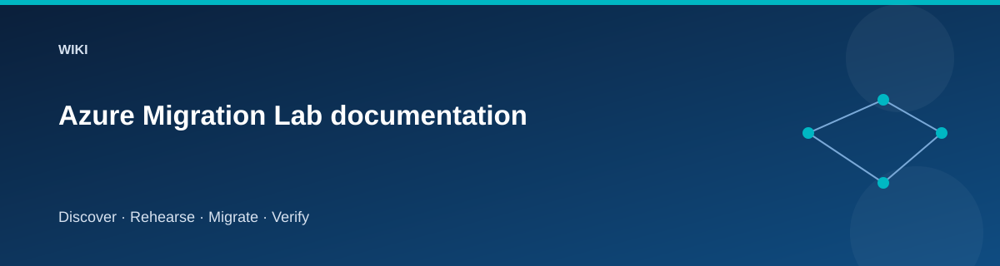

# Azure Migration Lab documentation

  

Learn migration by moving a working application and its data, proving the
result, and deliberately exercising the return path. The Azure-hosted source
keeps the baseline reproducible without a VMware cluster or physical lab.

## Choose a learning path

| Your goal | Follow |
|---|---|
| Understand the whole design before deploying | [Book-style guide](book.md) |
| Run the complete exercise | [Scenario workbook](scenarios/README.md) |
| Review migration decisions | [Foundations](architecture/foundations.md) and [assessment](scenarios/discover-assess.md) |
| Inspect infrastructure and security | [Architecture](architecture/overview.md), [network](architecture/network-topology.md), [security](architecture/security-model.md) |
| Recover a failed rehearsal | [Troubleshooting](reference/troubleshooting.md) and [rollback](scenarios/cutover-rollback.md) |

## What you will learn

- Why discovery and assessment precede moving a workload.
- How to rebuild an application host while migrating its database and files.
- How a rehearsal exposes permissions, compatibility, and timing problems.
- Why traffic cutover, business acceptance, and source deletion are separate.
- How infrastructure state, application state, and operation evidence interact.

## Article map

| Area | Pages |
|---|---|
| Architecture | [Overview](architecture/overview.md), [Foundations](architecture/foundations.md), [Network topology](architecture/network-topology.md), [Security](architecture/security-model.md), [Configuration flow](architecture/configuration-flow.md) |
| Scenarios | [Workbook](scenarios/README.md), [Preparation](scenarios/prepare.md), [Discovery and assessment](scenarios/discover-assess.md), [Application rehosting](scenarios/application-rehost.md), [SQL migration](scenarios/sql-migration.md), [File migration](scenarios/file-migration.md), [Rehearsal](scenarios/rehearsal.md), [Cutover and rollback](scenarios/cutover-rollback.md), [Acceptance and retirement](scenarios/accept-retire.md), [Real on-premises extension](scenarios/real-onpremises.md) |
| Reference | [Profiles](reference/environments.md), [Commands](reference/commands.md), [State and secrets](reference/state-and-secrets.md), [Costs](reference/costs.md), [CI/CD](reference/pipeline.md), [Troubleshooting](reference/troubleshooting.md) |
| Implementation | [Module guide](modules/README.md) |
| Testing | [Testing guide](testing/lab-testing-guide.md), [Live validation](testing/live-provisioning-validation.md), [Dated validation record](testing/validation-status.md) |
| Study and evidence | [Certification alignment](certifications/README.md), [Skill matrix](certifications/skill-matrix.md), [Operational templates](../docs/templates/README.md) |

## Conventions

Commands use PowerShell 7 from the repository root. Replace angle-bracket
placeholders with your own values. `$lab` means the common parameter hashtable
shown in the preparation guide. Resources and state are specific to the
selected environment.

Expected results describe acceptance criteria, not an assertion that a live
run has already happened. Read the dated validation record for actual results.
