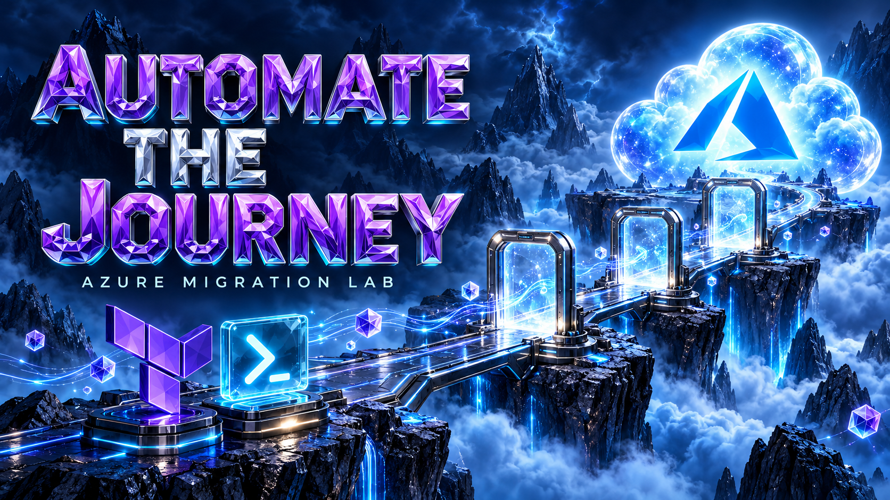

# Configuration and state flow

  

A profile describes desired infrastructure. The driver combines that profile
with explicit operator context, deploys four Terraform roots, and then performs
application migration stages using their outputs.

~~~mermaid
flowchart TD
    CLI["Environment + subscription + owner"] --> P["Selected profile"]
    P --> F["Foundation state"]
    F --> S["Source state"]
    F --> T["Target state"]
    S --> C["Cutover state"]
    T --> C
    S --> D["Migration driver"]
    T --> D
    C --> D
    D --> E["Journal + manifests + evidence"]
~~~

## Inputs

Specify `-Environment`, `-SubscriptionId`, and `-Owner` explicitly.
The selected Azure CLI subscription must match the intended lab. Profiles are
configuration choices, not aliases for whichever resources are already present.

Choose a stable environment name for the entire exercise. Changing profile
settings mid-migration can replace infrastructure and invalidate evidence.
Review the Terraform plan before accepting that consequence.

## Stack outputs are contracts

The driver needs resource group names, VM names, identity identifiers,
private service names, and application endpoints. These come from Terraform
outputs rather than hand-copied portal values. Null or absent outputs for a
disabled capability must be treated as unavailable.

Use `terraform output` against the correct root and its configured state.
Reading an empty default local state can look like a missing deployment.

## Persistent artifacts

The driver stores operation context under `work/<environment>/`.
Local Terraform state resides below `state/`; journal and migration manifests
track the workflow. Each operation writes its own timestamped evidence.

Keep all of these during a run. A new terminal can resume the same environment
when Azure login, state, and journal remain available. A new checkout without
state cannot safely infer resource ownership from matching names.

## Reviewable configuration changes

Change one behavior at a time: profile, infrastructure, guest script, or
migration procedure. Update the corresponding reference and run the relevant
checks. A Terraform plan cannot show a future SQL import or write-fence change;
review the migration stage separately.

## Related pages

- [Profiles](../reference/environments.md)
- [CLI reference](../reference/commands.md)
- [State and secrets](../reference/state-and-secrets.md)
