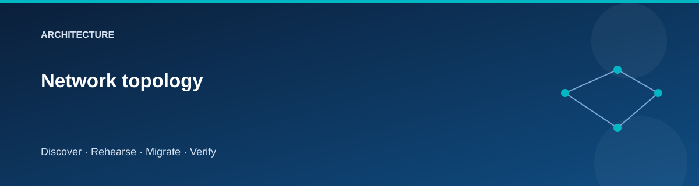
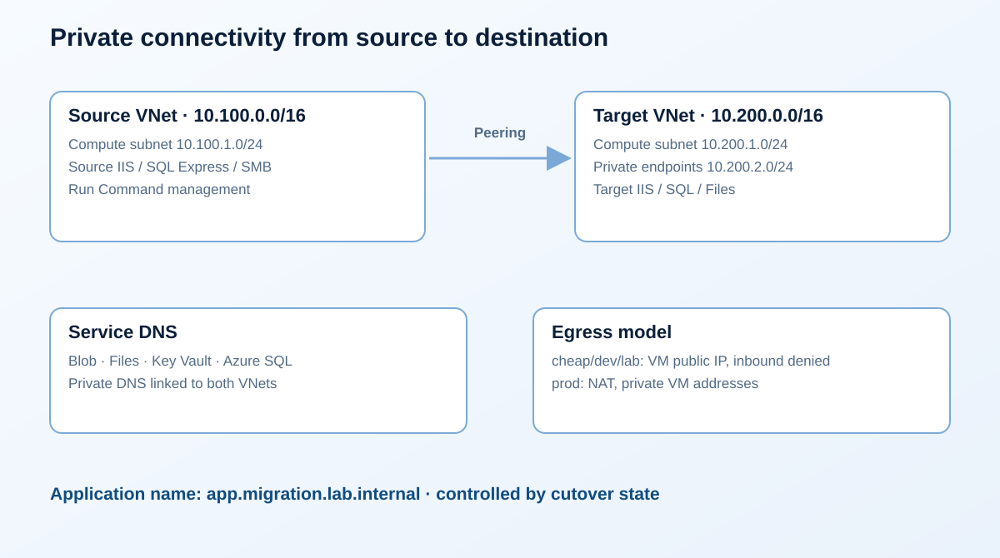

# Network topology

  

The source and target occupy separate, non-overlapping private address spaces.
Both are Azure VNets; the source represents an on-premises workload for this
exercise.

| Network | Prefix | Purpose |
|---|---|---|
| Source VNet | `10.100.0.0/16` | Simulated source location |
| Source compute | `10.100.1.0/24` | IIS, SQL Express, SMB host |
| Target VNet | `10.200.0.0/16` | Destination services |
| Target compute | `10.200.1.0/24` | Replacement IIS host |
| Private endpoints | `10.200.2.0/24` | Private service connectivity |

## Connectivity

Bidirectional VNet peering carries the lab's private traffic. Private endpoint
DNS zones are linked to the participating VNets. The service families include
Blob, Files, Key Vault, and Azure SQL. Test both DNS resolution and application
authorization; a private IP alone is not a permission grant.

The private application name is `app.migration.lab.internal`. The cutover
stack owns its site selection. Validation must observe resolution and a real
application response from within the lab network.

## Inbound and outbound access

Cheap, dev, and lab profiles use Standard public IPs for explicit VM egress.
Inbound access is denied by default. Optional administrator CIDR rules are an
explicit exception; do not configure `0.0.0.0/0` for RDP.

The prod profile uses NAT egress and private VM addresses. The default operating
path in every profile is Azure Run Command. A workstation without a private
connection should not expect to browse the private application name directly.

## Troubleshoot in dependency order

1. Confirm both VNets and connected peerings exist.
2. Resolve SQL and storage service names from the executing VM.
3. Confirm the destination is the private endpoint, not a public address.
4. Check outbound network policy and NSG rules for the required service.
5. Inspect identity and data-plane permissions.
6. Retry only after the failing dependency is understood.

Do not solve a private endpoint issue by temporarily enabling all public
networks. Record the failure and repair the DNS or route.

## Related pages

- [Security model](security-model.md)
- [Troubleshooting](../reference/troubleshooting.md)
