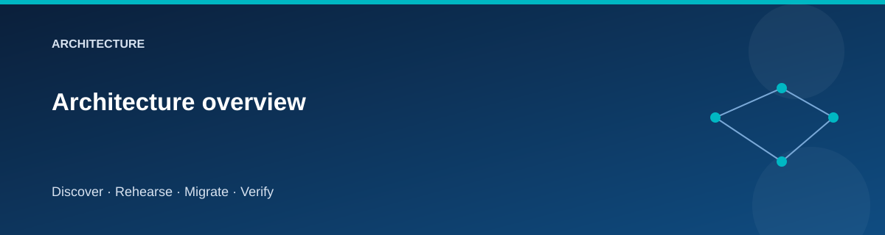
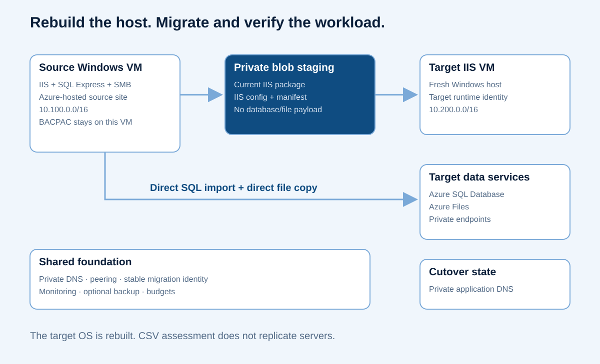

# Architecture overview

  

The lab has a source site, a target site, and a small shared foundation.
Direct peering provides private connectivity; there is no dependency on a
separately deployed landing-zone lab.

## Infrastructure ownership

| Stack | Owns | Why it is separate |
|---|---|---|
| Foundation | Resource groups, network fabric, shared security/storage/identities and management services | Remains available while source or target is rebuilt |
| Source | Windows application/data host and its source configuration | Can be retired after acceptance |
| Target | Replacement application host, Azure SQL and file target resources | Can be rehearsed and validated independently |
| Cutover | Logical application's private DNS selection | Switching traffic does not recreate infrastructure |

Consult the generated stack references for the exact resource and output
contracts. Private DNS and role assignments may be placed with their resource's
owning module; never use manual deletion as a substitute for the owning state.

## Application behavior

The sample exposes `/health/live`, `/health/ready`, `/api/status`, and
`/api/catalog`. Liveness proves the process responds. Readiness proves it can
reach its database. Status identifies the site and read-only state. The catalog
supports reading and adding demonstration rows.

A marker file controls the write fence dynamically. Read requests remain useful
for validation while writes are blocked. A browser that loads the home page
does not prove SQL or file migration succeeded.

## Identities and movement

Guest operations run on Azure VMs through Azure Run Command. Managed identities
access private staging, Azure SQL, and Azure Files. The developer workstation
does not need a public exception to private data services.

Blob staging carries the current IIS application package, IIS configuration,
and migration manifest. The SQL BACPAC remains on the source guest and is imported
directly into Azure SQL. File content is copied directly from source to Azure
Files and downloaded for comparison. Database and file payloads do not transit
the blob container.

~~~mermaid
sequenceDiagram
    participant Operator
    participant Source as Source guest
    participant Blob as Private blob staging
    participant SQL as Azure SQL
    participant Files as Azure Files
    participant Target as Target guest
    Operator->>Source: Run Command final migration
    Source->>Source: Fence app, SQL and SMB; validate sample schema
    Source->>Blob: Current IIS package, IIS config
    Source->>Source: Create consistent export copy and local BACPAC
    Source->>SQL: Import with migration managed identity
    Source->>Files: Copy content with OAuth REST
    Files-->>Source: Download for content comparison
    Source->>Blob: Migration manifest
    Operator->>Target: Run Command deploy
    Target->>Blob: Download package, config and manifest
    Target->>SQL: Read using runtime managed identity
    Target-->>Operator: Deployment and health result
    Operator->>Source: Run Command final validation
    Source->>SQL: Compare current source and target signatures
    Source->>Files: Download and compare current file content
    Source->>Target: Check readiness and fenced target status
    Source-->>Operator: Final comparison evidence
~~~

The foundation owns a stable migration user-assigned identity. It survives
source VM retirement, avoiding an orphaned SQL administrator assignment.
The target application's runtime identity has its own limited database access.

## Resource lifecycle

~~~mermaid
flowchart LR
    F[Foundation] --> S[Source]
    F --> T[Target]
    S --> C[Cutover]
    T --> C
    C --> V[Validate]
    V --> A[Accept]
    A --> R[Retire source]
~~~

Terraform manages infrastructure. The migration driver manages guest content
and migration transitions. Its journal and manifests are evidence of those
transitions, not substitutes for Terraform state.

## Related pages

- [Network topology](network-topology.md)
- [Configuration flow](configuration-flow.md)
- [State and secrets](../reference/state-and-secrets.md)
