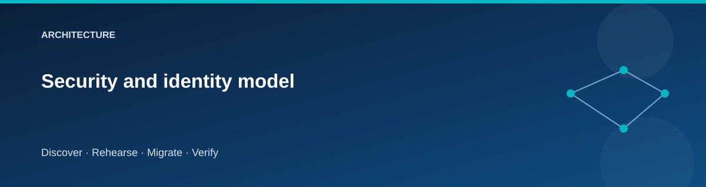

# Security and identity model

  

The lab separates infrastructure control, migration access, and application
runtime access. Each path should be explainable without a shared storage key or
SQL password in an application configuration file.

## Identity boundaries

| Identity | Role in the lab |
|---|---|
| Operator / CI federated identity | Provision and inspect the selected lab resources |
| Stable migration managed identity | Move data and initialize target SQL permissions |
| Source Windows application identity | Use Windows authentication to local SQL Express |
| Target application managed identity | Connect to Azure SQL with limited runtime permissions |

The migration identity is owned by the foundation and attached to source
compute as needed. Deleting the source VM does not delete that identity.

An attached managed identity is a VM trust boundary, not a process isolation
boundary. Processes on the source VM may be able to request its tokens. The
source must therefore remain a trusted synthetic lab host; do not attach this
migration administrator identity to an untrusted or compromised workload.

Azure SQL uses Microsoft Entra authentication. Application access still requires
a database principal and appropriate grants; assigning an Azure resource role
alone does not grant SQL table access. See
[Microsoft's authentication guidance](https://learn.microsoft.com/azure/azure-sql/database/authentication-aad-overview).

## Files and authorization

The migration uses Azure Files OAuth REST with a privileged data role.
This is an administrative content-transfer path. It can bypass file ACL
checks and therefore does **not** demonstrate end-user SMB permissions,
Kerberos, AD DS integration, or ACL equivalence. The file scenario explicitly
validates paths, sizes, and hashes instead.
[Microsoft documents the privileged behavior](https://learn.microsoft.com/azure/storage/files/authorize-oauth-rest).

## Transport boundaries

The demonstration IIS endpoint uses HTTP on private lab networks. Private
routing does not encrypt HTTP. Production adoption needs TLS, certificate
lifecycle management, and client trust validation.

The source's local SQL Express connection uses `TrustServerCertificate=True`
for its local self-signed instance. This exception belongs only to the source
guest's local SQL path. Azure SQL target connections verify the server
certificate; do not copy the source setting into the target connection string.

## Data and secrets

Use synthetic data only. Treat local state and plans as sensitive because VM
administrator passwords exist in state. Managed identity access tokens are
short-lived credentials; never write them to evidence or console logs.

Private storage, SQL, and vault endpoints reduce exposure, but a mis-scoped
role still permits unintended access. Keep role scope at the lab resource
boundary and inspect it during acceptance.

## Lifecycle controls

The source is fenced before the final copy: the app blocks writes, SQL is made
read-only, and the sample SMB share denies access after its open handles close.
The original share permissions are recorded for restoration. The target remains fenced through
validation and traffic cutover. Acceptance marks the boundary after which a
simple return to the source would lose target-side changes.

The driver owns the marker and freeze/unfreeze operations for the sample
database and the `MigrationLab` SMB share. It does not fence other databases,
shares, local-file writers, or external integrations. Extending the workload
requires identifying and controlling those writers explicitly.

The journal prevents casual out-of-order operations; it is not tamper-proof.
Do not edit a journal to bypass a failed check. Preserve the failure evidence
and use the documented recovery path.

Acceptance is persisted before opening target writes. If opening writes fails
partway through, retry Accept to finish it; do not roll back an environment
already recorded as accepted.

## Beyond this lab

Production migration requires application-specific transaction controls, TLS
and certificate management, identity continuity, audited approvals, backup
restore tests, retention controls, and load testing. The lab's production-like
profile adds selected controls, not all of those capabilities.

## Related pages

- [State and secrets](../reference/state-and-secrets.md)
- [Security exception register](../../SECURITY_EXCEPTIONS.md)
