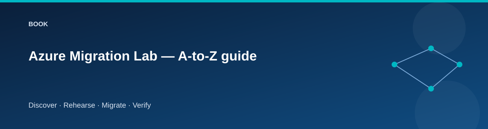

# Azure Migration Lab — A-to-Z guide

  

This guide explains the whole exercise as one migration story. Use it before the
[scenario workbook](scenarios/README.md), then return to individual chapters when
a stage fails or a design choice needs explanation.

## Part 1 — Start with the migration outcome

A successful migration is a set of observable outcomes. The application runs on
the intended target, its data is correct, access works under the new identity,
users reach the right endpoint, and the source can be removed without breaking
the destination. Copying a package is only one part of that result.

The sample catalog makes those outcomes small enough to inspect. Its source is
a Windows VM hosting IIS, SQL Express, and an SMB share. The target separates the
application VM from Azure SQL and Azure Files. That gives you both a host rebuild
and a data-platform change in one controlled exercise.

The source is hosted in Azure to avoid requiring physical equipment. Its network
is a simulated source site, not evidence of an on-premises migration. The
[extension guide](scenarios/real-onpremises.md) describes the additional work for
real discovery and server replication.

Before provisioning, write a short outcome statement: which records/files must
arrive, how the application should be reached, who accepts it, and how long a
write outage is acceptable. Use synthetic data and retain evidence privately.

## Part 2 — Understand what Terraform owns

Terraform builds the environment in four roots. Foundation establishes the
networks, resource groups, storage, stable migration identity, and shared
services. Source creates source compute. Target creates destination compute and
database services. Cutover owns the logical application's DNS choice.

This split is intentional. You can remove source compute after acceptance without
destroying the shared network or administrator identity. You can change traffic
routing without replacing a VM. You can inspect each operation's plan and state.

The implementation uses reusable modules for networking, Windows VMs, storage,
Key Vault, identity, monitoring, budgets, and SQL. The generated references
describe exact fields; the [module guide](modules/README.md) explains their
responsibilities.

Each root has a separate state. The PowerShell driver prepares isolated
Terraform working directories and passes outputs through nonsensitive manifests.
It does not rely on values manually copied from portal screenshots.

## Part 3 — Choose a profile and operating context

Start with cheap-lab. Dev provides a similar footprint for experiments; lab adds
operations exercises, and prod demonstrates NAT and selected governance controls.
All remain disposable single-region learning environments.

The profile does not authorize unlimited expenditure. Two Windows VMs, SQL,
disks, endpoints, and storage can incur charges even without traffic. Read the
[cost worksheet](reference/costs.md), define a session duration, and verify
cleanup after the exercise.

The operator supplies an explicit subscription and owner:

~~~powershell
$lab = @{
    Environment = 'cheap-lab'
    SubscriptionId = '<subscription-guid>'
    Owner = '<your-name>'
}
./scripts/Invoke-Lab.ps1 -Stage Preflight @lab
~~~

Preflight checks the context and capacity needed for the selected VM sizes.
A quota failure is useful information: choose a supported size deliberately
or obtain capacity. An automatic upgrade to a more expensive size would change
the experiment and its cost assumptions.

## Part 4 — Build a source you can explain

Provision creates infrastructure; Seed configures the guest workloads. Those are
different operations. A VM with a successful ARM provisioning state may still be
installing IIS, SQL Express, or the .NET runtime.

After Seed, verify the source's liveness, readiness, site identity, and catalog.
Liveness means the process answers. Readiness means the configured database is
usable. Status explains which site is answering and whether writes are fenced.
The catalog exposes the actual data that will be compared.

Capture baseline rows and files. The seeded sample should be reproducible, but
the evidence must come from the running source. If you change the sample,
record that change and assess whether the migration scripts support it.

The target is a fresh host. It does not inherit Windows configuration, local
accounts, or software from the source OS. Dependencies needed by a real
application must be identified and recreated explicitly.

## Part 5 — Discover before choosing a method

Discover records what exists. Assess-Export prepares inventory for the optional
assessment exercise. Inspect the results rather than treating discovery as a
button that automatically understands business dependencies.

Map the application's runtime dependencies separately from the migration path.
Runtime needs client routing, IIS, SQL, and any application file access.
Migration needs guest administration, staging, export/import tooling, identities,
and access to the destination. A successful runtime health check does not test
every migration dependency.

Azure Migrate CSV import can help you practice an initial assessment. It does not
replicate CSV-imported servers. Keep that assessment activity separate from the
actual data transfer performed by this repository.

Fill in the [assessment](../docs/templates/assessment.md) and
[dependency](../docs/templates/dependency-map.md) records. Identify the smallest
useful migration wave: the application, its catalog, and its demonstration files
move together because their verification belongs to one outcome.

## Part 6 — Understand consistency and identity

The final copy needs a stable source. The application write fence blocks new
catalog writes while reads remain available. This creates a controlled outage
for the sample and allows the export to represent a known dataset.

A production workload may have background writers, scheduled tasks, other APIs,
or external file clients. The sample's marker file is not a universal
transaction-consistency solution. You must identify and stop every relevant
writer in a real design.

SQL Express uses a local Windows application identity. Azure SQL uses Entra
authentication. Copying the local Windows user into the target would be the
wrong identity model. The migration therefore verifies its supported schema,
creates a portable export copy of the sample data, and initializes the target's
own runtime principal.

The foundation-owned migration identity has the administrative role needed to
perform this work. The target application's identity receives runtime access
separately. Removing the source VM does not remove the stable administrative
identity.

For files, the baseline verifies content, not Windows access-control equivalence.
Understand that boundary before calling a file-share migration complete.

## Part 7 — Rehearse the whole path

Rehearse executes the transfer against a disposable target while leaving the
logical name on source. This catches installation, network, identity,
compatibility, and validation failures before the real window.

Look at each stage. Did the package upload succeed? Was the expected database
export imported? Do row signatures match, including values and identity
information? Do the file path sets and hashes match? Is target readiness using
the destination database?

Record timings per stage. Do not compress the result into “migration took five
minutes” when three minutes were first-run package installation and two minutes
were data movement. The distinction matters when scheduling another attempt.

Reset-Target is a controlled way to clear disposable rehearsal content. It
requires the exact confirmation phrase and invalidates prior target evidence.
It is required after rehearsal or rollback before the next final migration.
It must never be used to erase an accepted, writable target.

## Part 8 — Run the final migration window

Resolve rehearsal blockers, confirm the expected dataset, and record the
cutover owner. Reset the rehearsed target, then run Migrate and Validate. Keep the source fenced while inspecting
the final comparison.

The final run needs its own evidence because the source may have changed since
rehearsal. A familiar filename or a matching row count is not enough. A content
signature detects changes that a count misses; path-and-hash file comparison
detects missing, extra, or changed content.

If a comparison fails, stop before Cutover. Preserve both sites and the evidence.
Determine whether the source changed during transfer, a tool failed, the target
contains leftovers, or the assumptions were unsupported. Use a supported recovery
path and validate again.

## Part 9 — Treat cutover as a traffic decision

Cutover changes the private application name to the target address. It does not
establish business acceptance or prove that clients have discarded cached DNS.

Test from inside the private network. Resolve the logical name, call the
application through it, inspect returned site identity, and check readiness.
The target remains fenced while these checks are performed.

Rollback before acceptance returns traffic to source and restores the intended
source behavior. Practice it deliberately. A return to source after it resumes
writes makes earlier target data potentially stale, so repeat final migration
and validation before another cutover.

## Part 10 — Know when the easy return path ends

Accept makes the verified target authoritative. After acceptance, target writes
can create data absent from source. Repointing DNS back to source would discard
those changes from the user's view.

The baseline closes the simple rollback path at acceptance. A real post-accept
recovery would require reverse synchronization, reconciliation, restore, or a
forward fix. Design that separately rather than describing a DNS change as a
complete rollback.

Record acceptance evidence and perform a controlled target write. Only then
retire source compute with the matching confirmation phrase. Verify that the
target remains healthy and shared resources still exist.

## Part 11 — Operate, observe, and clean up

Monitoring provides useful context: guest metrics, service diagnostics, SQL
auditing, and optional workbooks/backup in selected profiles. Observability
helps explain a failure; it does not replace data validation.

Scheduled shutdown can interrupt a late session. Review its UTC time before a
migration window. Budget alerts require configured recipients and do not stop
spending automatically.

Destroy the lab when finished, preserving state until resource deletion is
verified. Resource groups owned by foundation may remain after source retirement;
that is expected. They should disappear when their owning stack is destroyed.
Destroy removes the dedicated assessment group after verifying its environment
tag. Assessment or appliance resources outside that owned group need separate cleanup.

## Part 12 — Make the evidence reusable

A useful evidence pack includes commit, tool versions, profile, inventory,
assessment decisions, package/data signatures, stage timings, health results,
cutover/rollback observations, acceptance, and cleanup.

Keep raw evidence private. Commit only redacted, intentional summaries. The
[dated validation record](testing/validation-status.md) must distinguish tests
actually run from intended behavior.

Use the [certification matrix](certifications/skill-matrix.md) as a study aid.
Explain why each check exists, not just which command produced it. The strongest
learning result is being able to describe what the lab proves and what a more
complex workload would still need.
