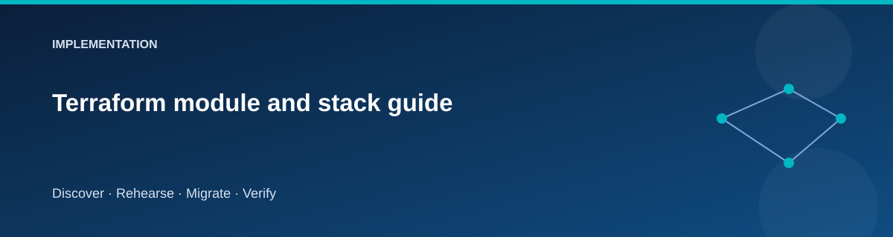

# Terraform module and stack guide

  

The infrastructure uses small reusable modules and four orchestration roots.
The split makes it possible to retire source compute while preserving the
target and shared foundation.

## Module families

| Module | Responsibility |
|---|---|
| networking | Source/target VNets, subnets, peering, NSGs and egress |
| windows-vm | Windows host, NIC, managed identity attachment and shutdown |
| storage | Private staging and Azure Files resources |
| keyvault | Lab vault and private connectivity |
| identity | Stable migration user-assigned identity |
| monitoring | Log Analytics, collection and supporting operations resources |
| budget | Optional recipient-based cost alerts |
| sql | Entra-authenticated Azure SQL target |

Generated module references are authoritative for exact inputs and outputs.
Read the corresponding stack reference to see composition and dependencies.

## Root manifests

Each stack emits a nonsensitive `manifest` object used by the migration driver.
The foundation manifest includes subscription/environment identity, resource
groups, subnets/private addresses, storage names, DNS identifiers, migration
identity IDs, and optional monitoring/backup IDs.

Source and target manifests identify their VMs and service context. Cutover
describes the active application routing. These are interface contracts:
changing a field requires updating every consumer and its tests.

## Feature flags

Profiles select supporting controls such as NAT, monitoring, workbooks, backup,
policy, and public-RDP exceptions. A disabled feature should produce a clearly
absent optional output and no accidental dependency on it.

## Extending a module

1. Add a typed input with a documented default.
2. Define resource ownership and lifecycle.
3. Check profile combinations and security implications.
4. Update generated references and the relevant scenario.
5. Test consumers of any changed manifest.
6. Explain cost and state impact in the pull request.

Avoid adding a migration step as a Terraform local-exec side effect. Keep
infrastructure planning and data operations separately reviewable.

## Related pages

- [Configuration flow](../architecture/configuration-flow.md)
- [Profiles](../reference/environments.md)
