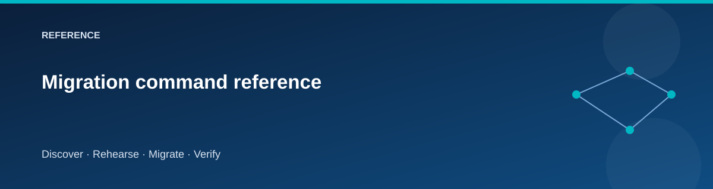

# Migration command reference

  

Run the entry point from the repository root in PowerShell 7.2 or later.

~~~powershell
$lab = @{
    Environment = 'cheap-lab'
    SubscriptionId = '<subscription-guid>'
    Owner = '<your-name>'
}
./scripts/Invoke-Lab.ps1 -Stage Preflight @lab
~~~

## Common parameters

| Parameter | Meaning |
|---|---|
| Stage | Lifecycle operation listed below |
| Stack | Stack selected by Plan: foundation, source, target, or cutover |
| Environment | cheap-lab, dev, lab, or prod |
| SubscriptionId | Explicit Azure subscription GUID |
| Owner | Resource ownership label |
| ConfirmAction | Exact phrase for a destructive stage |
| PlanOnly | Provision/Plan: save a plan without applying |
| BackendResourceGroup | Existing Azure state account's resource group |
| BackendStorageAccount | Existing Azure state account |
| BackendContainer | State container; default tfstate |

A new environment's PlanOnly run can plan foundation only until dependent
outputs exist. It does not fabricate plans for stacks whose prerequisites have
not been created.

Use the explicit Plan stage to review one stack:

~~~powershell
./scripts/Invoke-Lab.ps1 -Stage Plan -Stack foundation @lab
~~~

## Stages

| Stage | Purpose | Evidence/checkpoint |
|---|---|---|
| Preflight | Check tools, subscription and VM capacity | Prerequisite result |
| Plan | Save a plan for the selected stack without applying | Saved plan and log |
| Provision | Apply four infrastructure stacks | State + stack manifests |
| Seed | Configure source sample and target prerequisites | Source/target bootstrap results |
| Discover | Read source inventory | Inventory JSON |
| Assess-Export | Prepare assessment CSV | CSV and inventory assumptions |
| Rehearse | Exercise transfer to a disposable target | Rehearsal comparisons |
| Reset-Target | Clear disposable target migration content | Reset result; earlier evidence invalidated |
| Migrate | Final consistent copy with source fenced | Final migration evidence |
| Validate | Compare target and migration expectations | Health, SQL, files |
| Cutover | Point private application name at target | DNS/site validation |
| Rollback | Return to source before acceptance | Source routing and behavior |
| Accept | Make the verified target authoritative | Acceptance transition |
| Retire-Source | Remove source-owned compute | Retirement result |
| Destroy | Tear down the lab in dependency order | State/resource deletion |

The script enforces allowed state transitions. A failed transition is a reason
to inspect the journal and operation evidence, not to manually overwrite status.

## Destructive confirmations

~~~powershell
./scripts/Invoke-Lab.ps1 -Stage Reset-Target @lab -ConfirmAction 'RESET TARGET cheap-lab'
./scripts/Invoke-Lab.ps1 -Stage Retire-Source @lab -ConfirmAction 'RETIRE SOURCE cheap-lab'
./scripts/Invoke-Lab.ps1 -Stage Destroy @lab -ConfirmAction 'DESTROY cheap-lab'
~~~

Replace the environment suffix when using another profile. Acceptance and source
retirement are separate stages. Simple rollback is blocked after acceptance.

## Artifacts

The driver writes `work/<environment>/journal.json`, stack JSON under
`manifests/`, and timestamped stage evidence below `evidence/`.
Local state is under `state/<stack>.tfstate`. Generated guest scripts and logs
can reveal infrastructure context; keep them private.

## Related pages

- [Scenario workbook](../scenarios/README.md)
- [State and secrets](state-and-secrets.md)
