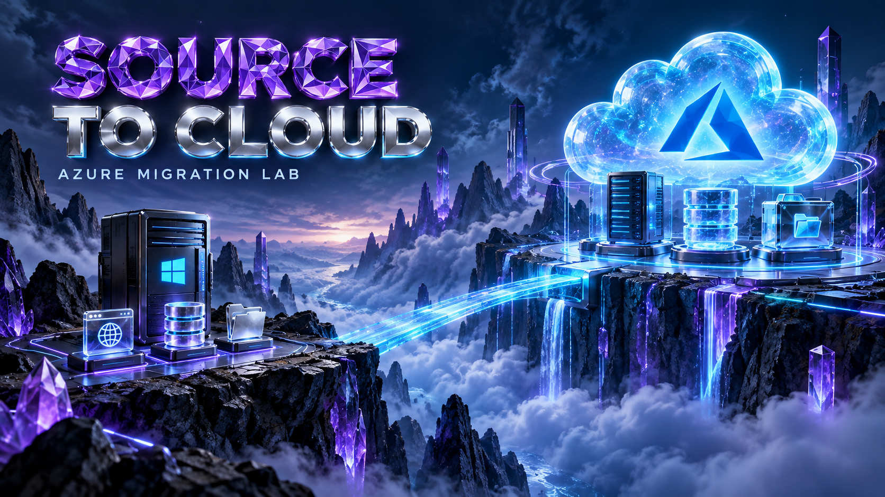

# Cost planning and cleanup

  

The default is cost-conscious, but the source simulator and target are real
Azure resources. Estimate a short session before deployment rather than copying
a monthly figure from another lab.

## Billable components

| Component | Cost driver | Control |
|---|---|---|
| Windows source + target | Running hours, VM size, OS licensing | Short sessions and shutdown |
| Managed disks | Provisioned size/tier even while VM stops | Destroy disposable resources |
| Azure SQL Database | Basic tier, 2 GB maximum in baseline | Review capacity before changing the sample |
| Private endpoints | Endpoint hours and processed traffic | Include every enabled service |
| Storage and Files | Capacity, operations, redundancy | Small synthetic dataset and cleanup |
| Public IPs / NAT | Allocated hours and traffic | Profile choice |
| Log Analytics | Ingestion and retention | Daily cap, useful collection only |
| Backup | Protected instances and retained data | lab/prod only, inspect teardown |
| Assessment extension | Manually created supporting resources | Separate inventory and cleanup |

Use [Azure Pricing Calculator](https://azure.microsoft.com/pricing/calculator/)
for the current region and subscription agreement. Record the estimate date,
currency, runtime assumption, and selected SKUs.

## A useful worksheet

~~~text
planned session hours:
VM running-hour estimate:
disks + SQL + endpoint hours:
storage / transfer / logging allowance:
optional NAT / backup allowance:
total estimate:
actual cost after the session:
unexplained difference:
~~~

Budget alerts notify; they do not enforce a hard spending limit. The profiles
leave budget recipients empty until you configure them. Scheduled VM shutdown
does not delete disks, SQL, storage, endpoints, or NAT.

## Before leaving the lab

- Record the stage and whether either site is write-fenced.
- If continuing later, keep state and evidence and understand ongoing costs.
- If finished, run Destroy with the matching confirmation phrase.
- Check expected resource groups and Terraform state for residual resources.
- Verify cleanup of the owned assessment group; remove external assessment or
  appliance resources separately.
- Record any retained backup or storage item and its owner.

## Related pages

- [Profiles](environments.md)
- [Acceptance and retirement](../scenarios/accept-retire.md)
