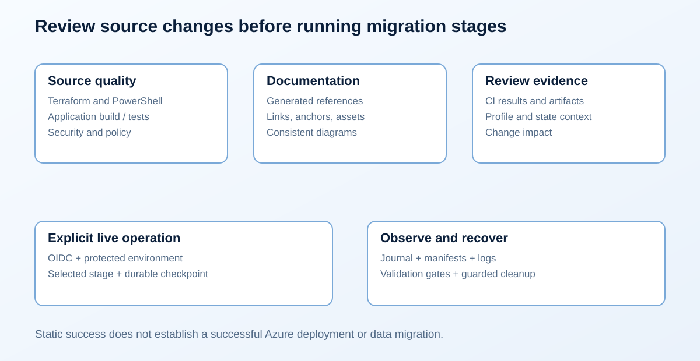

# CI/CD and operating model

  

Automated quality checks should make repository changes reviewable. Live
migration stages require an identified environment, durable state, and a
deliberate lifecycle decision.

## Pull request checks

Validate runs credential-free on pull requests, pushes to main, and manual
dispatch. Its static gate covers Terraform formatting/validation, provider and
module checks, policy/security/secret scanning, PowerShell parsing and tests,
application build/tests, workflow syntax, and documentation links/assets.
Read the actual workflow for the installed tool versions and enforced checks.

A green static pipeline proves the checks ran against the source revision.
It does not prove guest package installation, Azure identity propagation,
SQL import, DNS cutover, or successful teardown.

## Azure authentication

Use GitHub OIDC for hosted automation. Configure the federation subject for
the intended repository and environment, with minimal job permissions.
Do not add subscription passwords or storage account keys to the repository.

A pull request from untrusted code must not receive deployment credentials.
Live operations should be explicitly selected and tied to a protected environment.

## Durable execution

The four Terraform states must use a consistent backend. The migration journal
and evidence need a durable, access-controlled location too. A fresh runner
that restores Terraform state but loses the journal cannot safely resume a
partially completed migration.

The manual Migration lab workflow restores an encrypted-at-rest checkpoint from
the protected backend account. It contains the journal, manifests, and inventory;
it excludes Terraform state, plans, data exports, and guest packages. Workflow
concurrency serializes each profile. Local remote-state operators must also use
the same checkpoint through the supplied synchronization helper.

Serialize operations per environment. Preserve the exact commit, profile,
manifest, and artifact identity used for a planned operation. Do not apply a
saved plan from another environment or revision.

## Lifecycle gates

Provision, final migration, cutover, acceptance, retirement, and destroy are
different operations. A deployment pipeline should expose their decision points,
not collapse them into a push-triggered job.

Use the [CLI](commands.md) for the initial local workflow. Before enabling any
live workflow, verify its actual stage coverage, backend configuration, artifact
retention, environment protections, and failure behavior.

Follow [GitHub setup](../../.github/SETUP.md) for the plan/apply/destroy environment
names, federated identity subjects, variables, backend protection, and checkpoint
recovery. The workflow only permits its live operations from protected main.

## Related pages

- [State and secrets](state-and-secrets.md)
- [Testing guide](../testing/lab-testing-guide.md)
