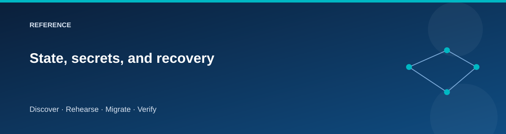

# State, secrets, and recovery

  

A migration has several kinds of state. Recovering only one does not recover
the entire exercise.

| State | Purpose | Location |
|---|---|---|
| Terraform | Infrastructure resource ownership | Four state files or remote keys |
| Journal | Lifecycle status and operation history | work/environment/journal.json |
| Manifests | Stack outputs and migration comparisons | work/environment/manifests and evidence |
| Application data | Catalog rows and files | Source, staging, target |
| DNS | Current logical destination | Cutover Terraform state |

## Local backend

The driver uses isolated Terraform work directories and absolute local state
paths under `work/<environment>/state/`. Run the entry point consistently.
Running Terraform directly in a repository stack with default state can create
a second, unrelated ownership record.

Keep the work directory through failures, restarts, and teardown. Back it up
securely if the workstation is not durable. Never commit state, plan files,
generated credentials, tokens, or unredacted run evidence.

## Remote backend

The driver can use an existing Azure Storage backend through the backend
parameters. Keys follow:

~~~text
azure-migration-lab/<environment>/<stack>.tfstate
~~~

Use Microsoft Entra authentication and a separately managed state account.
The backend is a prerequisite, not a resource to destroy with the lab.
Give the execution identity the required container access and network path.

Supply the same backend parameters to **every** subsequent invocation.
Do not switch from local to remote mid-run without an explicit state migration.
The repository does not claim to migrate state automatically.

Remote Terraform state does not persist the local migration journal or evidence.
CI and replacement workstations must restore those artifacts securely and must
serialize operations for the same environment.

## Secret handling

VM administrator passwords are generated and kept in Terraform state. They are
not ordinary manifest outputs. Azure SQL uses Entra-only authentication; the
application and migration access use managed identities.

Guest context contains resource names and identity IDs. Redact private context
before sharing logs, even when no credential is present. Treat a saved Terraform
plan as sensitive.

## Recovery sequence

1. Stop competing operations for the environment.
2. Preserve all state, journal, and failed-operation evidence.
3. Verify the Azure subscription and selected backend.
4. Inspect the actual resource/data/DNS state.
5. Compare it with the last completed journal checkpoint.
6. Use the documented retry, reset, or rollback path.
7. Record the recovery and rerun the required validation.

A stale journal cannot prove that a partial SQL import or DNS update rolled
back. Keep both sites until their actual condition is understood.

## Retirement ownership

Foundation owns resource groups, networks, and the stable migration identity.
Retire-Source destroys the source stack's compute; it does not delete the
foundation resource group containing source networking.

## Related pages

- [Troubleshooting](troubleshooting.md)
- [Cutover and rollback](../scenarios/cutover-rollback.md)
