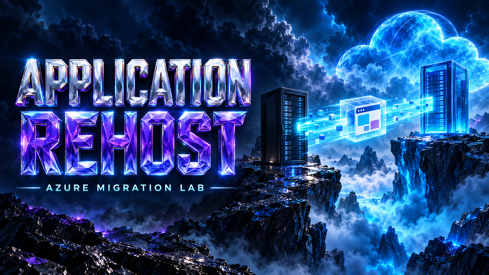
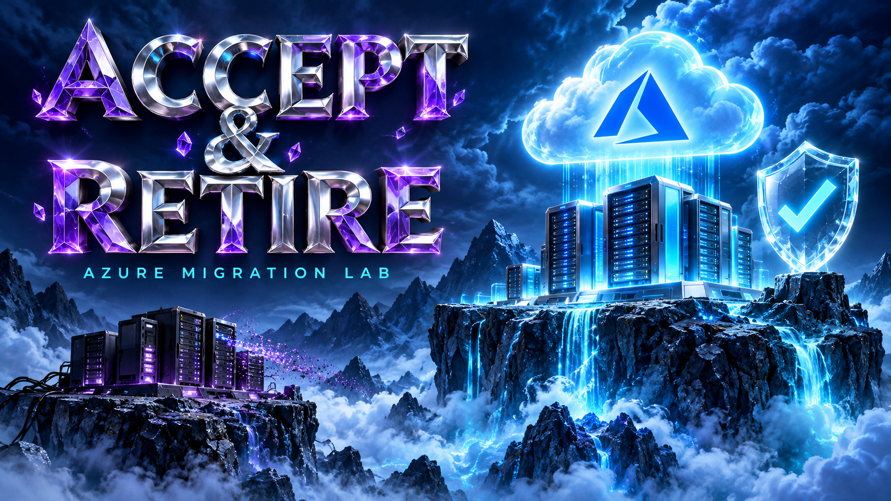

# Visual gallery

The lab uses 12 cinematic illustrations with a shared palette of midnight navy,
electric cyan, sapphire blue, and crystalline violet. Chrome lettering,
holographic clouds, and mountain platforms connect the cover and chapter art.
Each image introduces a topic; the SVG and Mermaid diagrams explain its actual
technical behavior.

## Explore the collection

Select a chapter link beneath an image to open the exercise or guide.

| Lab cover | Migration playbook | Source to cloud |
|---|---|---|
|  |  |  |
| [Start the lab](../../README.md): follow the Windows migration journey. | [Read the book](../book.md): understand each stage and its evidence. | [Explore the architecture](../architecture/overview.md): connect the source and destination. |

| Secure foundations | Discover and assess | Application rehost |
|---|---|---|
|  |  |  |
| [Prepare the foundation](../architecture/security-model.md): private access, identities, and secrets. | [Discover and assess](../scenarios/discover-assess.md): gather dependencies and plan the move. | [Rehost IIS](../scenarios/application-rehost.md): transfer the application onto a new server. |

| SQL migration | File migration | Rehearse and validate |
|---|---|---|
|  |  |  |
| [Migrate SQL](../scenarios/sql-migration.md): freeze writes, import, and compare data. | [Migrate files](../scenarios/file-migration.md): copy and verify supported file properties. | [Rehearse the move](../scenarios/rehearsal.md): prove the target before changing normal traffic. |

| Cutover and rollback | Accept and retire | Automate the journey |
|---|---|---|
|  |  |  |
| [Control cutover](../scenarios/cutover-rollback.md): keep target writes disabled while acceptance is pending. | [Accept and retire](../scenarios/accept-retire.md): enable target writes before safely retiring the source. | [Configure automation](pipeline.md): protected workflows and recorded checkpoints. |

After target writes are enabled, recovery requires data reconciliation; the
cutover artwork does not imply that reversing DNS is a lossless rollback.

## Use and extend the style

- Keep a landscape composition, a short readable title, and generous safe
  margins around the lettering.
- Use violet crystal and silver chrome for titles, with cyan light separating
  the technology objects from dark navy scenery.
- Choose one clear scene for each topic and put commands, addresses, service
  relationships, and detailed labels in the accompanying technical diagrams.
- Add descriptive alt text and an explanation below each illustration. Keep
  the page heading and all instructions as selectable text.
- Reuse the relevant chapter cover for related reference pages. The original
  SVG banners remain available in `wiki/images/`.

The 12 original PNGs are 1672 × 941 pixels and live in
`wiki/images/cinematic/`. The [exact generation prompts](../images/cinematic/prompts.json)
are saved with the assets for future additions. Images are embedded from local
repository paths and need no external image hosting.

## Provenance and interpretation

Created on 29 October 2026 with the built-in OpenAI image generation tool,
using the user's Azure FinOps reference image as visual direction. These are
new migration illustrations; the supplied reference image is not redistributed
in this repository. No CLI or separate API fallback was used.

The images are conceptual illustrations, not Azure screenshots or deployment
evidence. Project artwork is distributed with this repository under its
[MIT license](../../LICENSE). Azure and Windows names and marks belong to
Microsoft, and Terraform belongs to its respective owner; their appearance
identifies the technologies used and does not imply endorsement.

Return to the [documentation home](../README.md) or
[scenario workbook](../scenarios/README.md).
