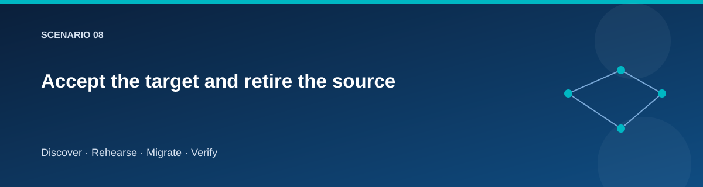

# Accept the target and retire the source

  

## Objective

Make the target authoritative only after verification, then remove source
compute deliberately without destroying shared infrastructure.

## Acceptance

Review the [acceptance record](../../docs/templates/acceptance.md). Confirm
current target site identity, SQL readiness, catalog content, file comparison,
and logical DNS routing. Record the final migration run and unresolved findings.

~~~powershell
./scripts/Invoke-Lab.ps1 -Stage Accept @lab
~~~

Acceptance crosses the simple rollback boundary. The target can become writable;
new writes must be treated as authoritative target data. Do not use Rollback or
Reset-Target to undo an accepted migration.

Perform a controlled catalog write after acceptance, confirm it is visible,
and record that the target's runtime identity has the intended permissions.

## Source retirement

~~~powershell
./scripts/Invoke-Lab.ps1 -Stage Retire-Source @lab -ConfirmAction 'RETIRE SOURCE cheap-lab'
~~~

The source stack owns source compute. Its resource group and network may belong
to foundation, so an empty or partially populated source resource group is not
automatically a cleanup failure.

Verify that source VM resources are removed, target remains healthy, shared
networking and storage still exist, and the stable migration identity remains
valid. Complete the [retirement checklist](../../docs/templates/retirement.md).

## Final teardown

When the learning exercise is complete:

~~~powershell
./scripts/Invoke-Lab.ps1 -Stage Destroy @lab -ConfirmAction 'DESTROY cheap-lab'
~~~

The teardown must respect dependencies: cutover and workloads before foundation.
Review failures and remaining resources; a returned shell prompt is not proof
that all billable resources were deleted.

Keep state and logs until Azure resource deletion and state cleanup have been
verified. Destroy also removes the dedicated assessment resource group after
checking its environment tag, including a portal-created project placed there.
Assessment/appliance resources created outside that owned group need separate
cleanup and must be listed in the retirement inventory.

## Deliverables

Acceptance decision, post-accept write check, source retirement inventory,
teardown result, and a final record of remaining resources or retained data.

## Related pages

- [Live validation](../testing/live-provisioning-validation.md)
- [Cost worksheet](../reference/costs.md)
