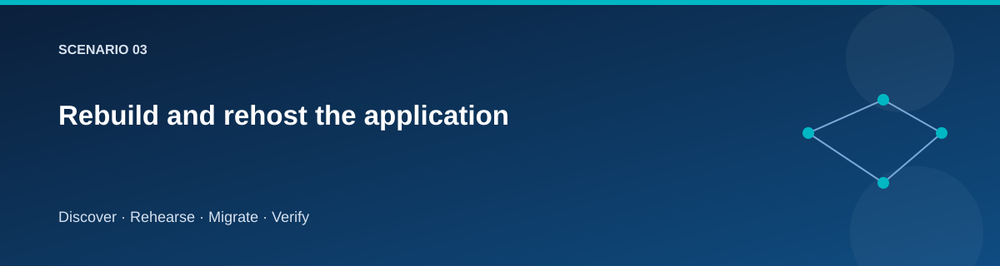

# Rebuild and rehost the application

  

## Objective

Prove that the application can run on a fresh target VM using target services.

The source and target use Windows Server 2022 with IIS. The application is
a small .NET catalog service. The migration transfers application content and
configuration through private staging; it does not copy the source OS disk.

## What changes at the target

| Concern | Source | Target |
|---|---|---|
| Database | Local SQL Express | Azure SQL Database |
| Authentication | Windows identity | Managed identity |
| Site identity | Source | Target |
| Write behavior during validation | Fenced for final copy | Fenced until acceptance |
| Infrastructure | Existing sample host | Newly provisioned host |

The target package must be configured for its own database endpoint and identity.
Copying source connection settings unchanged is a failed migration.

## Run the scenario

The application deployment is included in Rehearse and Migrate:

~~~powershell
./scripts/Invoke-Lab.ps1 -Stage Rehearse @lab
~~~

Use the resulting guest validation evidence to inspect:

- `/health/live`: process responds.
- `/health/ready`: application can access the configured database.
- `/api/status`: expected site and read-only state.
- `/api/catalog`: expected records from the target database.

A response from a cached source hostname is not proof of target health. Inspect
the resolved private address and returned site identity.

## Negative checks

A write request must fail while the target write fence is active. A deliberately
invalid database configuration should make readiness fail even if liveness
remains healthy. Run destructive or fault-injection experiments only on a
disposable rehearsal target.

## Evidence and limitations

Capture package identity/hash where available, deployment result, runtime
configuration without secrets, endpoint results, and database signature.
The sample does not test arbitrary IIS modules, COM components, domain service
accounts, scheduled tasks, certificates, or third-party licensing.

## Related pages

- [SQL migration](sql-migration.md)
- [Rehearsal](rehearsal.md)
- [Testing guide](../testing/lab-testing-guide.md)
