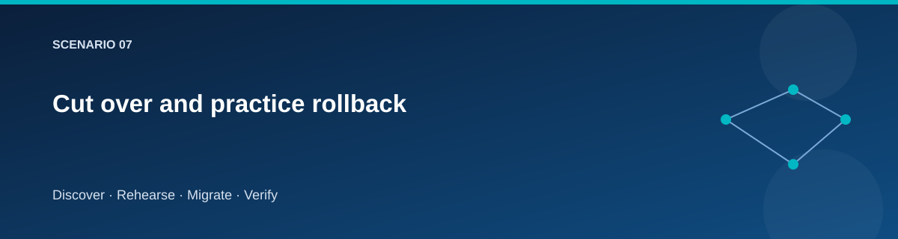
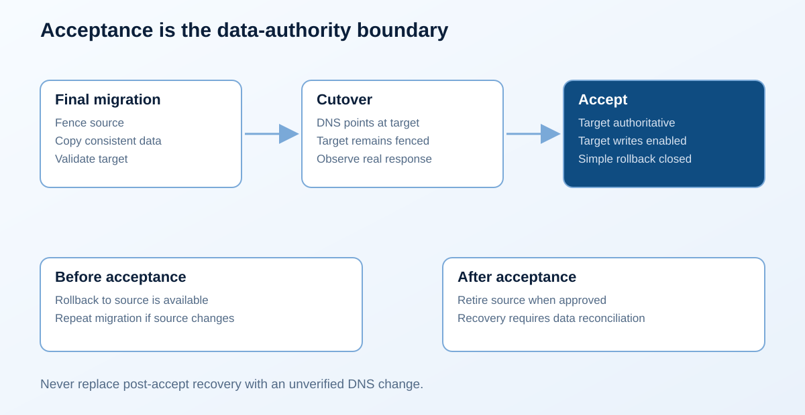

# Cut over and practice rollback

  

## Objective

Move the private application name to a validated target while retaining a
safe return path until acceptance.

## Final migration gate

If the target has been used for rehearsal or rollback, reset it first with
`Reset-Target` and the matching confirmation phrase. A fresh discovered source
can proceed directly; target content is never silently dropped.

~~~powershell
./scripts/Invoke-Lab.ps1 -Stage Migrate @lab
./scripts/Invoke-Lab.ps1 -Stage Validate @lab
~~~

Expected: the source's final data is transferred, schema/content/file checks
pass, and target readiness succeeds with writes still blocked. Review the
latest evidence, not an earlier rehearsal.

Complete the [cutover checklist](../../docs/templates/cutover.md), including
who can accept the result and when rollback must be chosen.

## Switch the logical name

~~~powershell
./scripts/Invoke-Lab.ps1 -Stage Cutover @lab
~~~

The dedicated cutover Terraform state selects the target private address.
Check DNS from the lab network and call the application through the logical
name. DNS caches may retain the previous answer temporarily; record the
observed transition rather than assuming it is immediate.

Cutover does not equal acceptance. The target stays write-fenced while
you inspect application behavior and retain the uncomplicated rollback route.

## Roll back before acceptance

~~~powershell
./scripts/Invoke-Lab.ps1 -Stage Rollback @lab
~~~

Expected: the logical name returns to source and the source is restored to its
intended operating state. Check site identity, readiness, and write behavior.
Record why rollback was selected and what must change before another attempt.

If the source resumes writes, its data may diverge from the target. Run
Reset-Target, then a new final migration and validation before the next cutover.

## Rollback boundary

After Accept, target writes may create data that never existed on source.
The baseline therefore disallows a simple rollback after acceptance. Recovery
then requires a separate data reconciliation or forward-fix plan.

If cutover fails partway through, inspect both the DNS state and journal before
retrying. Keep source and target intact until the actual traffic destination
is known.

## Related pages

- [Acceptance and retirement](accept-retire.md)
- [State and secrets](../reference/state-and-secrets.md)
