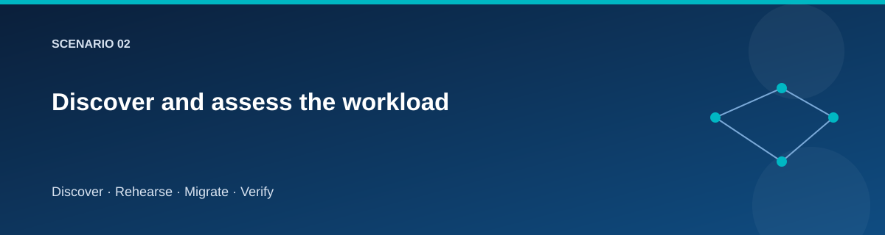

# Discover and assess the workload

  

## Objective

Turn a running sample into a migration decision with explicit compatibility
limits and measurable acceptance criteria.

~~~powershell
./scripts/Invoke-Lab.ps1 -Stage Discover @lab
./scripts/Invoke-Lab.ps1 -Stage Assess-Export @lab
~~~

## Inspect what discovery found

Inventory should identify the host and operating system, application endpoints,
local SQL Express/database shape, sample rows, file paths, and connections to
target services. Check that the inventory describes the running source rather
than assumptions copied from a profile.

Fill in [the dependency map](../../docs/templates/dependency-map.md). Trace:
client → logical name → IIS → database; and migration guest → staging → target.
Identify which dependency is needed for runtime and which is only for migration.

## Assessment decisions

| Question | Baseline answer to verify |
|---|---|
| Can the OS be replaced? | The sample is redeployed to a fresh Windows host |
| Is the SQL schema supported? | Only the known demonstration Catalog schema |
| Must Windows database users survive? | No; target application uses managed identity |
| Must NTFS permissions remain identical? | No; this lab verifies file content |
| Is a write outage allowed? | Yes, during the controlled final-copy window |
| Can DNS be changed privately? | Yes, through the dedicated cutover state |

Document departures before running the next stage.

## Optional Azure Migrate assessment

Assess-Export produces inventory for an import-based exercise. Download the
current template from Azure Migrate, compare its columns with the export, and
upload through the portal's CSV discovery route. Inspect warnings and save the
resulting assessment with its assumptions. CSV import is assessment-only;
no replication or server migration is initiated.
[Official workflow](https://learn.microsoft.com/azure/migrate/tutorial-discover-import).

Do not invent CPU history or performance percentiles. A small synthetic source
is useful for learning the interface, not capacity planning a real enterprise
application.

## Deliverables

- Completed [assessment record](../../docs/templates/assessment.md).
- Dependency diagram and chosen destination for each component.
- A [wave plan](../../docs/templates/wave-plan.md) with owner and rollback deadline.
- Assessment export, portal findings if used, and compatibility exceptions.

## Next

[Application rehosting](application-rehost.md) and [rehearsal](rehearsal.md).
