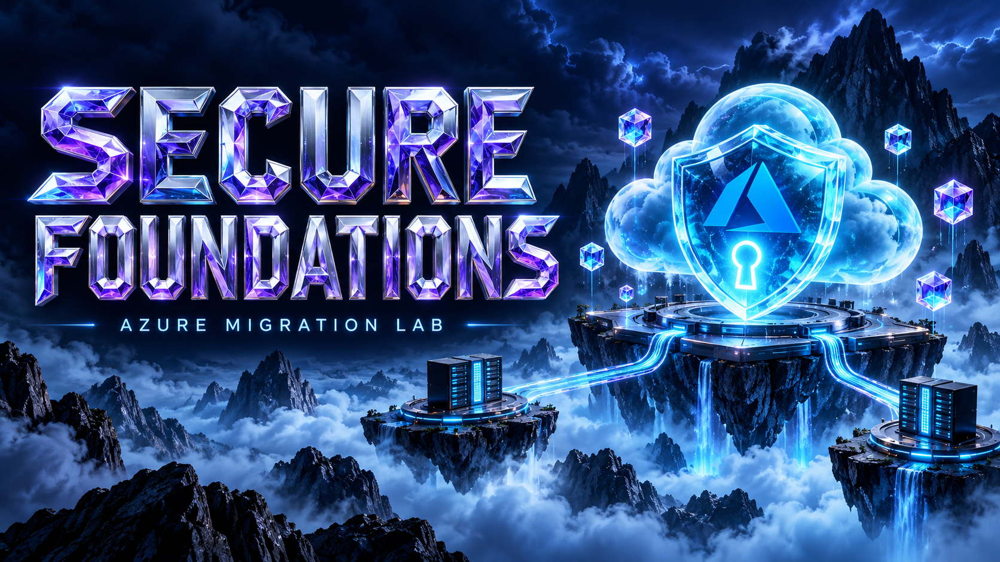

# Prepare the migration lab

  

*Prepare identities, network access, and isolated environments before moving the workload.*

## Objective

Establish a known source, an isolated target, and a repeatable operating context
before copying any data.

## Prerequisites

- An Azure subscription and permissions to create the lab resources and role
  assignments. Role assignment permissions are needed in addition to ordinary
  resource deployment.
- PowerShell 7.2 or later, Azure CLI, and the pinned Terraform version.
- .NET SDK version from global.json for local application builds and tests.
- Capacity for two Windows VMs in West Europe and the selected profile's services.
- A protected local working directory with sufficient space for state/evidence.
- No production or customer data.

Read [costs](../reference/costs.md) before choosing a profile. Confirm that local
security controls permit the guest's Microsoft downloads and Azure endpoints.

## Set operator context

~~~powershell
az login
az account show --output table
$lab = @{
    Environment = 'cheap-lab'
    SubscriptionId = '<subscription-guid>'
    Owner = '<your-name>'
}
./scripts/Invoke-Lab.ps1 -Stage Preflight @lab
~~~

Expected: prerequisite and subscription checks complete. A failure here is a
setup issue; do not skip it by editing the journal.

## Build and seed

~~~powershell
./scripts/Invoke-Lab.ps1 -Stage Plan -Stack foundation @lab
./scripts/Invoke-Lab.ps1 -Stage Provision @lab
./scripts/Invoke-Lab.ps1 -Stage Seed @lab
~~~

Provision creates infrastructure in dependency order. Seed prepares the
demonstration application, SQL Express catalog, and file content on the source.
Installing guest packages may take longer than creating the VM.

The first Plan can review foundation. Dependent stack plans require real
foundation outputs. Provision plans and applies each stack in sequence; it is
a live operation, not a request for another interactive approval prompt.

Expected: the source application answers liveness/readiness, catalog data
exists, and inventory can identify the sample content. The initial logical
application name points to the source.

## Evidence to capture

- Commit and tool versions.
- Selected profile and subscription identifier in private evidence.
- Resource groups and Terraform outputs.
- Source site identity, readiness result, row inventory, and file baseline.
- Any quota, package download, or identity propagation delays.

## Stop conditions

Stop if source and target prefixes overlap with a connected network, the wrong
subscription is selected, or an installation fails. Retain state and logs.
The driver operates through Azure Run Command; public RDP or HTTP is not a
prerequisite for the standard path.

## Next

[Discover and assess](discover-assess.md).
