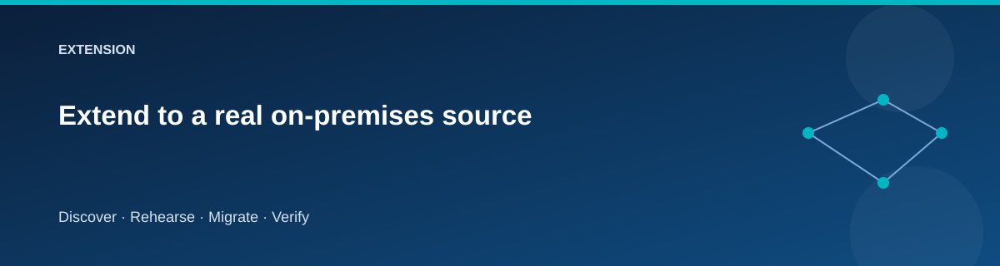

# Extend to a real on-premises source

  

The baseline uses an Azure VM to make the learning exercise self-contained.
A real source environment adds discovery access, compatibility constraints,
network design, and a different migration mechanism.

## Choose the intended exercise

| Goal | Additional work |
|---|---|
| Assess VMware/Hyper-V/physical inventory | Follow the relevant Azure Migrate discovery appliance guidance |
| Replicate and migrate whole servers | Select a supported server migration route and validate its current prerequisites |
| Move an actual SQL database | Assess SQL compatibility, authentication, features, size, and downtime requirements |
| Move a real SMB file server | Plan client identity, ACLs, ownership, namespace, locks, and incremental synchronization |

Do not label a newly provisioned Azure VM as a replicated on-premises server.
The baseline scripts support the sample Catalog schema and content transfer;
they are not generic import tools for a customer's environment.

## A controlled extension path

1. Use disposable source machines and synthetic data.
2. Choose the source platform and supported migration method.
3. Read the current [Azure Migrate documentation](https://learn.microsoft.com/azure/migrate/).
4. Prepare discovery credentials, connectivity, appliance capacity, and access
   according to that method's requirements.
5. Discover and assess; record blockers without suppressing them.
6. Build an isolated test-migration network.
7. Test application consistency, data, identity, DNS, and rollback.
8. Record resource ownership and a cleanup plan for appliance-created resources.

The appliance and migration service may create resources outside the baseline
Terraform states. Inventory them explicitly; Terraform Destroy cannot remove
resources it does not own.

## Design record

Write down source platform/version, workload dependencies, required ports,
account privileges, target choice, data size/change rate, downtime target,
test-migration procedure, and rollback/reconciliation strategy.

The extension is documentation guidance in this repository. A successful
baseline run does not validate appliance discovery, server replication, or
production migration readiness.
