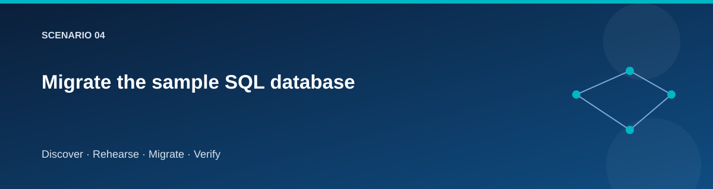

# Migrate the sample SQL database

  

## Objective

Move a consistent sample database into Azure SQL and prove that supported schema,
identity values, and catalog content survive.

## Supported schema boundary

The migration is deliberately specific to `dbo.Catalog` with
`Id` as its identity key and `Name` and `Quantity` columns. The script checks
the expected shape and rejects unsupported user objects. Arbitrary databases,
SQL Agent jobs, linked servers, CLR objects, cross-database dependencies, and
server logins require a separate migration design.

Source IIS uses a Windows database user. That user must not be blindly exported
into Azure SQL. The guest creates a disposable export database containing the
supported schema/data without source Windows users, preserves identity values
and gaps, exports the portable database, and removes the temporary copy after
the operation.

## Data path

~~~mermaid
flowchart LR
    F["Fence source writes"] --> S["Check supported schema"]
    S --> C["Consistent export copy"]
    C --> B["BACPAC on source VM"]
    B --> T["Direct import to private Azure SQL"]
    T --> V["Compare source/export/target"]
~~~

The stable migration identity performs administrative migration work. The target
application receives its own database principal with runtime permissions.

## Execute and inspect

~~~powershell
./scripts/Invoke-Lab.ps1 -Stage Rehearse @lab
# After rehearsal findings have been resolved:
./scripts/Invoke-Lab.ps1 -Stage Reset-Target @lab -ConfirmAction 'RESET TARGET cheap-lab'
./scripts/Invoke-Lab.ps1 -Stage Migrate @lab
./scripts/Invoke-Lab.ps1 -Stage Validate @lab
~~~

Compare row count, ordered content signature, and schema/identity information.
A matching row count alone misses changed quantities and swapped names.
Check that the source write fence remained in place during the final snapshot.

## Failure handling

If export, import, or comparison fails, retain source and evidence.
Do not perform Cutover. Inspect partial target state before retrying. Use
Reset-Target only when the target contains disposable rehearsal data; it is
not a repair strategy for an accepted, writable target.

## Evidence to capture

- Supported-schema check and source signature.
- Export package identity and transfer result.
- Target signature, record count, and identity behavior.
- Runtime identity connection/readiness result.
- Start/end timestamps and observed write outage.

## Related pages

- [Rehearsal](rehearsal.md)
- [State and secrets](../reference/state-and-secrets.md)
