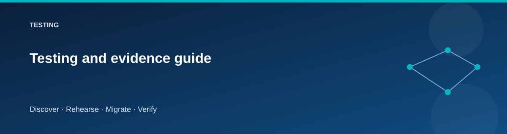

# Testing and evidence guide

  

Tests answer different questions. Keep static correctness, Azure provisioning,
and migration success distinct in every report.

| Layer | Question |
|---|---|
| Formatting/schema | Can the source be parsed and validated? |
| Offline behavior tests | Are allowed transitions and data comparisons correct? |
| Infrastructure smoke | Do the intended Azure resources and private paths exist? |
| Guest/application checks | Is the installed application using the correct services? |
| Data validation | Did the expected rows and file bytes arrive? |
| Lifecycle exercise | Do cutover, rollback, acceptance and retirement behave correctly? |
| Teardown | Are disposable resources and state removed as expected? |

## Local static checks

The complete repository gate uses pinned quality tools:

~~~powershell
./scripts/quality/Install-QualityTools.ps1
# Add work/tools to PATH as directed by the installer.
./scripts/quality/Test-Repository.ps1
~~~

Use the .NET SDK pinned in global.json, Python 3.12 or later with the pinned
Checkov package, and the Pester version required by the quality script. The
gate includes mocked Terraform tests, PowerShell tests, application behavior,
documentation references, and security/policy scans. See
[GitHub setup](../../.github/SETUP.md) for the equivalent CI environment.

For a focused initial pass:

~~~powershell
terraform fmt -check -recursive
$stacks = 'foundation', 'source', 'target', 'cutover'
foreach ($stack in $stacks) {
    terraform "-chdir=stacks/$stack" init -backend=false -lockfile=readonly
    if ($LASTEXITCODE -ne 0) { throw "Init failed: $stack" }
    terraform "-chdir=stacks/$stack" validate
    if ($LASTEXITCODE -ne 0) { throw "Validation failed: $stack" }
}
dotnet restore ./app/MigrationLab --locked-mode
dotnet build ./app/MigrationLab --no-restore
node ./scripts/quality/Test-Documentation.mjs
~~~

Use the repository's test scripts and CI workflow for the complete current
PowerShell/application/security test set. Dependency downloads require network
access; record unavailable tools instead of claiming skipped checks passed.

## Required behavioral scenarios

- Reject a stage that has not satisfied its prerequisites.
- Reject mismatched subscription/environment context.
- Require the exact destructive confirmation phrase.
- Detect same-row-count content changes.
- Detect missing, extra, same-size-but-changed files.
- Reject unsupported database objects.
- Keep target writes fenced before acceptance.
- Reject rollback/reset after acceptance.
- Preserve identity values and gaps through the sample export path.
- Prevent concurrent operations for the same environment.

## Live smoke checks

Inspect resources, private DNS resolution, correct managed identity, SQL runtime
grants, and guest installation. Check application liveness separately from
readiness. Validate the logical DNS name from the private network.

Capture every expected and observed result, including failures. Resource existence
and a successful HTTP response are weaker evidence than a full data comparison.

## Reporting

Record commit, profile, region, timestamp, test command, result, and evidence
location. Use the [validation record](validation-status.md). A result remains
“not run” until the check actually completes.

## Related pages

- [Live validation procedure](live-provisioning-validation.md)
- [Scenario workbook](../scenarios/README.md)
