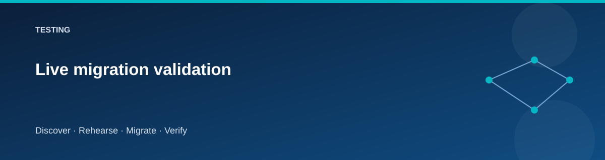

# Live migration validation

  

This procedure defines the evidence needed for a verified live lab. It creates
billable Azure resources and changes demonstration data. The repository's initial
local package does not imply this procedure has been run.

## Before the run

Record commit, subscription, profile, region, tool versions, budget, and dataset
identity. Use a disposable environment with no production data. Confirm the
journal/state location and available VM quota.

## Minimum complete run

1. Preflight, Provision, and Seed.
2. Discover and Assess-Export.
3. Rehearse; inspect all comparison results.
4. Reset-Target with its exact confirmation, then Migrate and Validate.
5. Cutover; verify DNS, target site, readiness, and blocked writes.
6. Rollback before acceptance; verify source site and behavior.
7. Reset-Target, then repeat final migration/validation/cutover.
8. Accept; perform a controlled target write.
9. Confirm post-accept rollback/reset is rejected.
10. Retire-Source; verify target health and shared resources.
11. Destroy; verify resource and state cleanup.

Do not automate acceptance of failed checks. An unexpected data difference is
a failed run, even if infrastructure was created correctly.

## Evidence matrix

| Area | Expected proof |
|---|---|
| Infrastructure | Intended resource groups, VMs, private services, no unexpected public access |
| SQL | Source/export/target schema and content signatures agree |
| Files | Relative paths, lengths, and hashes agree |
| Application | Correct site, live/ready results, expected catalog |
| Fences | Source/target write behavior at each checkpoint |
| Cutover | Private DNS and response identify target |
| Rollback | Private DNS and response identify source before acceptance |
| Acceptance | Target writes succeed; simple rollback is unavailable |
| Retirement | Source-owned compute absent, target still healthy |
| Destroy | Owned resources removed; remaining items documented |

## Failure recovery

Retain state and evidence on failure. Determine whether the source was fenced
and whether DNS changed. Restore service using the supported stage when possible;
otherwise record the actual condition before further mutation.

If cleanup fails, record the remaining resource IDs and owning state. Resolve
the error and repeat teardown. Never mark cleanup complete merely because the
migration stage failed.

## Result record

Update [validation status](validation-status.md) with actual outcomes and
redacted evidence locations. Preserve raw evidence privately, not in the public
repository. Verify the owned assessment group's removal and separately clean
any Azure Migrate resources created outside it.
